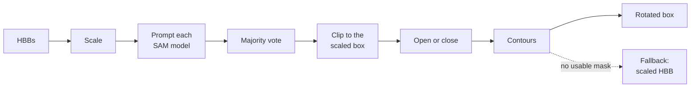

# How the conversion works

`hbb2obb` converts one image at a time. Every HBB in the image's label file becomes exactly one OBB, in the same order and with the same class, so line *i* of the output describes the object on line *i* of the input.



The steps below name the flag that controls each one. The defaults are those of the `hbb2obb` command.

## 1. Read the HBBs

The HBBs come from `<hbb_dir>/<image stem>.txt`, YOLO format, with an optional 6th column holding a detector confidence. Whether the coordinates are relative or in pixels is decided from every coordinate in the file. An empty file is a frame with no objects. See [Annotation formats](data-format.md).

## 2. Scale the prompts

`--scale_factors` / `-sf` (default `0.05`) moves each edge of a box outward by that fraction of its own side, so a side grows by twice the factor in total. A negative factor moves the edges inward. With two values, the first applies to the shorter side of each box and the second to the longer one. Scaled boxes are clipped to the image.

The scaled box is both the prompt SAM receives and the region the mask is later clipped to, so a box that is too tight cuts off part of the object for good. See [Limitations](practice.md#limitations).

## 3. Segment

Each model in `--sam_models` / `-sm` (default `sam_b`) is prompted with all of the image's scaled boxes at once, at inference resolution `--imgsz` (default 1280). Ultralytics drops a mask whose predicted quality is below its `conf` threshold (default 0.25); when a model returns fewer masks than it was given boxes, `hbb2obb` prints a warning naming the model and the image.

For each box, each model contributes the mask with the most pixels inside the scaled box.

## 4. Vote

With several models, a pixel is kept when at least `n // 2 + 1` of the `n` masks claim it:

| Models | Must agree |
| ---: | ---: |
| 1 | 1 |
| 2 | 2 |
| 3 | 2 |
| 4 | 3 |
| 5 | 3 |

An even-sized ensemble is therefore unanimous at two models and stricter than the next odd size above it. A pair keeps only the pixels both masks share.

## 5. Clip

The voted mask is cut to the inside of the scaled box. Nothing outside the prompt can enter the OBB.

## 6. Open or close

`--opening_kernel_percentage` / `-okp` (default `0.15`) applies one morphological operation with a square kernel. Its side is the magnitude of the value times the shorter side of the upright rectangle around the mask's largest region, made odd and at least 3 px. The sign picks the operation:

| Value | Operation | Effect |
| :--- | :--- | :--- |
| positive | opening | removes thin protrusions and specks; can only remove pixels |
| negative | closing | fills holes and bridges small gaps, such as a vehicle split by glare or a pole; can only add pixels |
| `0` | none | |

## 7. Take the contour

The outer contours of the mask are found, and one is **valid** when its area is at least 10% of the scaled box's and it fills at least 20% of its own upright bounding rectangle. The largest valid contour is kept.

`--fragment_ratio` / `-fr` (default `0.1`) then adds every other piece whose area is at least that fraction of the largest one's, so an object an occluder split in two is fitted as one. `0` keeps the largest piece alone. With more than one piece, the box is fitted to their convex hull.

## 8. Fit the rotated box

`cv2.minAreaRect` fits the minimum-area rotated rectangle to the contour, and its four corners, in integer pixels, are the OBB.

## Fallback

When no model produced a mask overlapping the scaled box, or no contour is valid, the OBB is the **scaled box itself**: axis-aligned, with confidence `0.0`, and with no contour behind it. Its polygon line, under `--save_polygon`, is the same rectangle.

The run ends with the number and share of boxes that fell back:

```text
Wrote 201 boxes over 3 frames to data/labels_obb
Fallback to HBB: 0 boxes (0.00%)
```

[Convert HBBs to OBBs](convert.md#fallbacks) covers the flags that warn on or fail a run over a share of fallbacks, and [Troubleshooting](troubleshooting.md#many-boxes-fall-back) what to try when there are many.

## Confidence

Each OBB is scored in `[0, 1]` from how tightly the box wraps the contour and how far the models agreed. See [Confidence scores](confidence.md).

## In Python

Each step is a function in [`hbb2obb.converter`](../reference/api/converter.md): [`scale_bounding_boxes`](../reference/api/converter.md#hbb2obb.converter.scale_bounding_boxes), [`aggregate_masks_by_majority_vote`](../reference/api/converter.md#hbb2obb.converter.aggregate_masks_by_majority_vote), [`apply_morphological_opening`](../reference/api/converter.md#hbb2obb.converter.apply_morphological_opening) and [`merge_fragment_contours`](../reference/api/converter.md#hbb2obb.converter.merge_fragment_contours), all called by [`hbb2obb()`](../reference/api/converter.md#hbb2obb.converter.hbb2obb).
